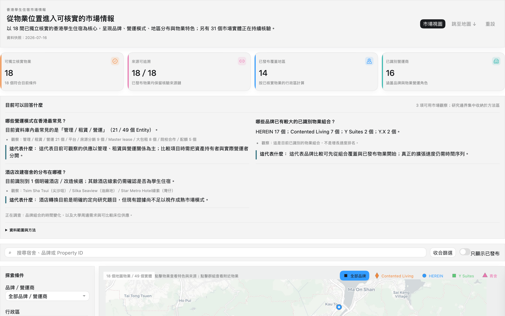

# 香港学生公寓（PBSA）交互地图 · Hong Kong Student Hostel Map

> **在线交互体验（手机 / 电脑浏览器直接打开）**：**[https://rainshadowqaq.github.io/hk-student-hostel-map/](https://rainshadowqaq.github.io/hk-student-hostel-map/)**

将分散在香港各学生住宿运营商官网与香港城市规划委员会（TPB）公开记录中的零散信息，整理成手机和电脑浏览器打开即用的单页交互式情报地图。



---

## 为什么做这个地图

在调研香港专用学生住宿（PBSA）及酒店改建宿舍市场时，品牌分布、运营模式（管理/租赁、包租、院校合作）、床位规模与规划申请记录往往散落在几十个运营商网页和政府 PDF 里。这个静态网页把已核对公开来源的物业坐标、运营模式和出处链接收拢到一张交互视图里，方便直接按区域和品牌定位核查。

---

## 核心交互

- **多维筛选与来源溯源**：支持按品牌/运营商、行政区、资料可信度及物业名称/ID 即时筛选；点击点位可查看运营模式、床位概览与原始公开来源链接。

---

## 数据来源与公开边界声明

- **公开来源**：本页面内嵌的运营商、物业、参考价格区间与规划记录均整理自公开运营商网站、香港高校公开页面、香港持牌旅馆/政府公开名录及公开财经新闻报道。
- **使用边界**：本项目仅用于市场研究方法展示与 GIS 可视化演示，不构成商业报价、投资建议或最新法律/规划合规定论；具体物业条款与实时租金请以各运营商官方发布为准。

---

## 本地预览

```sh
python3 -m http.server 8000
# 打开 http://127.0.0.1:8000/
```
